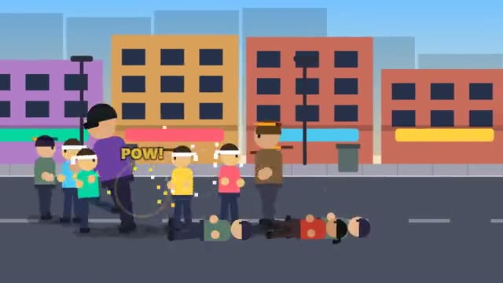

# Street Squad

Punch through the goons. Then take down the boss. A multiplayer starter game from [Multiplayer Agent](https://multiplayeragent.com): 2D, co-op, 1–4 players, with AI buddies that fill empty seats.

## How it plays

Walk down the street and fight off each wave of goons together: punch three times for a combo, kick to knock them flat, jump-kick into a crowd. Clear all three areas and The Boss comes out. Goons sometimes drop food that heals you. Knocked out? You're back up in a few seconds, as long as someone in the squad is still standing.

**Controls:** Arrow keys or WASD, J punch, K kick, Space jump; on touch, drag to move and tap the buttons.

## Make it yours in the Game Builder

Open the [Game Builder](https://multiplayeragent.com), choose **Start from a starter game** and pick Street Squad. It opens as version 1 in your studio, ready to play and publish. Then ask for changes, for example:

- Add a baseball bat you can pick up and swing
- Add a special move that hits everyone around you
- Make the street a pirate harbor with sailor goons

## Run it yourself

1. Get a free publishable key (`pk_…`) at [multiplayeragent.com](https://multiplayeragent.com).
2. In `index.html`, put it in place of `pk_REPLACE_ME` in the `MP_CONNECT` block.
3. Open `index.html` in a browser. No build step and no server needed.

Without a key it still runs, offline with AI buddies.

## How it is built

- One `index.html`. The comment at the top of the script maps the code and explains the multiplayer.
- The goons, the waves and the stages are plain lists in `ENEMIES`, `WAVES` and `STAGES`.
- **Host-run rules:** The host's browser runs the goons, the boss and the waves; if it leaves, the next player takes over.
- **Bots:** AI buddies fight beside you until enough people join.
- **Leaderboard:** Each player's best score.
- **Live sync:** Every punch, knockdown and K.O. shows up for the whole squad at once.
- `?attract` runs it offline with buddies only. The preview video is recorded from it.

## License

MIT.
